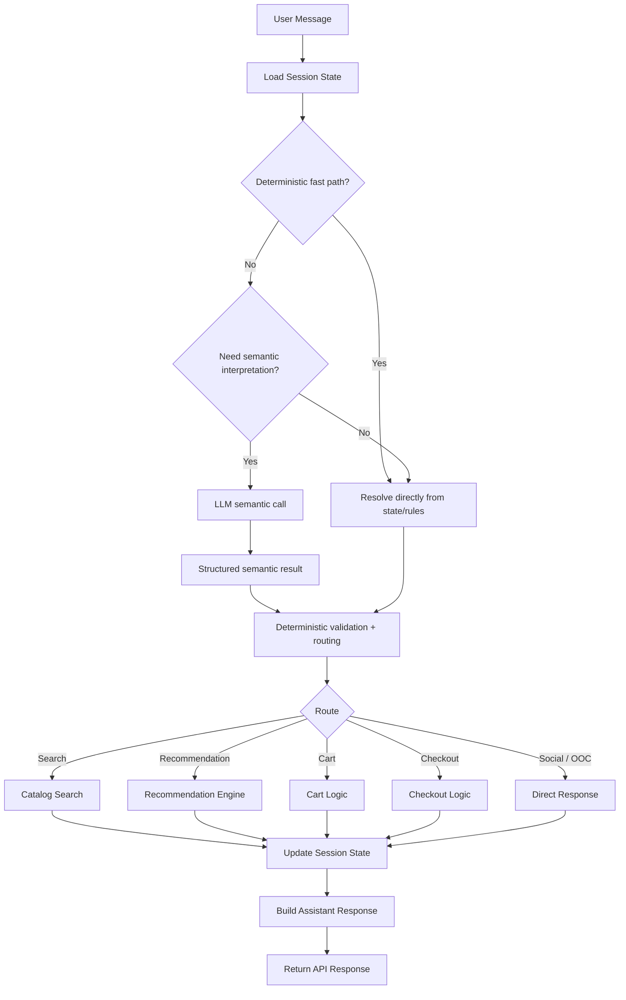
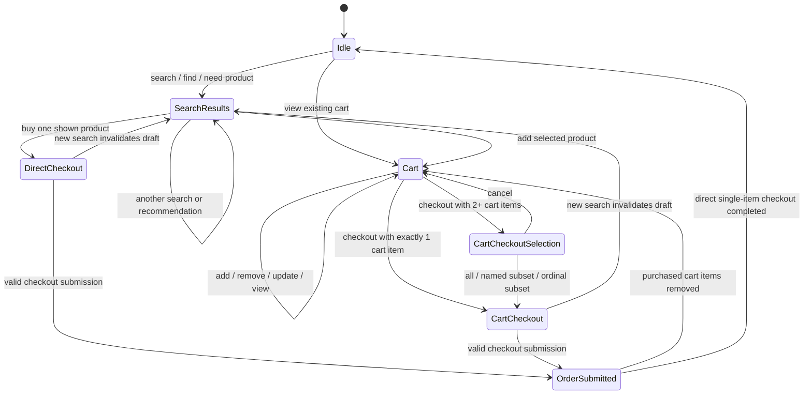
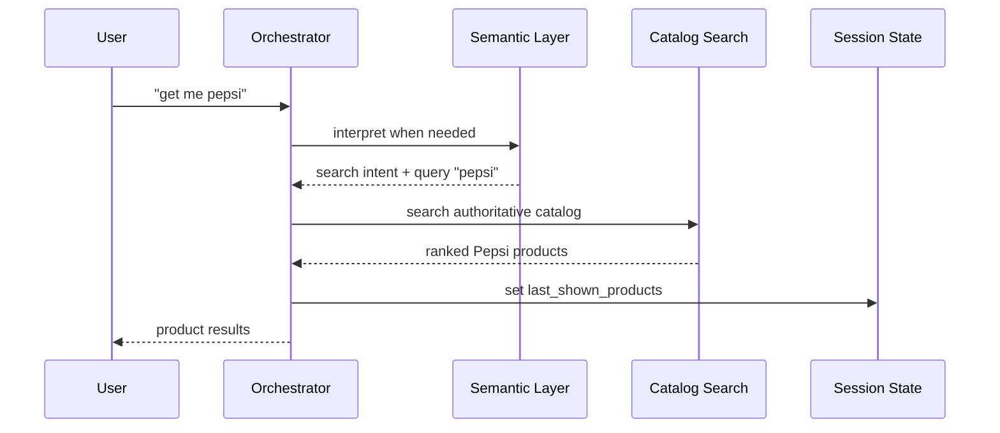
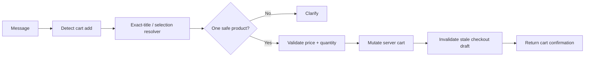
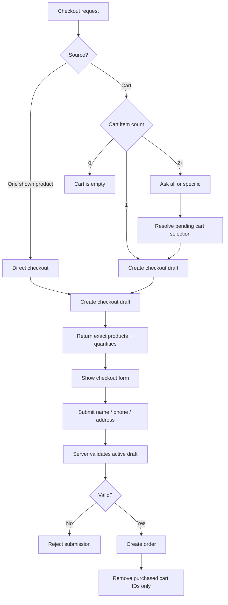
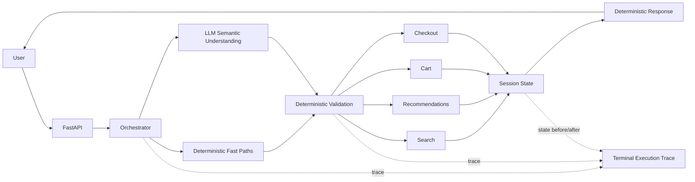
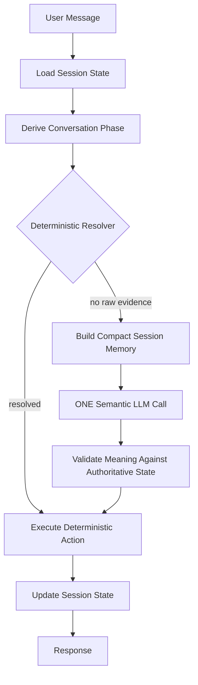
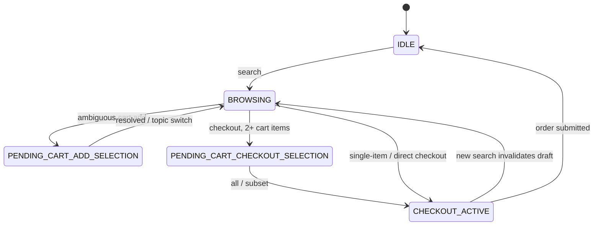
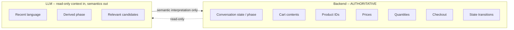

# Spini — State, Orchestration, and Per-Message Execution Flow

## 1. Purpose

This document explains how **Spini**, the conversational shopping assistant, processes every user message.

For each turn, we want to answer:

1. What state existed before the message?
2. Was the message handled deterministically or did it need semantic interpretation?
3. Was the LLM called?
4. What structured action was produced?
5. What authoritative application logic ran?
6. What state changed?
7. What response was returned?

> This is an execution/state trace, not private LLM chain-of-thought.

---

## 2. Core Architecture Principle

Spini separates **language understanding** from **commerce authority**.

```text
User language
    ↓
Semantic understanding
    ↓
Structured action / intent
    ↓
Deterministic application logic
    ↓
Catalog / Search / Cart / Checkout
    ↓
Authoritative state update
    ↓
Assistant response
```

The LLM may help understand what the user means, but it does **not** have final authority over:

- product IDs
- prices
- cart contents
- quantities
- checkout products
- checkout totals
- order validation

Those are controlled by deterministic server-side code and catalog/session state.

---

## 3. High-Level Message Pipeline



---

## 4. Main Session State

```text
Session
├── conversation_history
├── last_shown_products
├── recent_shown_pages
├── cart
├── pending conversational action / selection
├── checkout_draft
└── request trace / route information
```

### `conversation_history`

Bounded recent conversation context. It is not authoritative for products, prices, cart items, or checkout items.

### `last_shown_products`

The most recent visible product page. This is the strongest positional authority for:

```text
the first one
the fifth one
the last one
الأول
الخامس
الأخير
```

### `recent_shown_pages`

A bounded history of recently shown product pages, useful for resolving recent named references.

### `cart`

Durable server-side shopping intent.

Rules:

- search does not clear the cart
- recommendation does not clear the cart
- quantities are server controlled
- unknown-price products cannot enter the purchasable cart
- multiple products intended for one purchase use the cart flow

### Pending action / selection

Used when Spini needs one more answer.

Example:

```text
User: checkout
```

With 2+ cart items, Spini asks:

```text
Would you like to checkout all of them or choose specific products?
```

The next message is resolved against the **cart**.

### `checkout_draft`

The exact server-authoritative products being purchased now.

It can come from:

1. one directly selected shown product, or
2. one/subset/all cart products

A new search invalidates an open checkout draft. A backend restart also removes non-persisted runtime session state, so an old browser checkout form can become stale.

---

## 5. State Machine



---

## 6. Who Decides What?

### LLM responsibility

The LLM is used only when semantic understanding is needed.

Examples:

```text
get me pepsi
add the fifth one to cart
now i want to buy
checkout Pepsi and sardine
ضيف الأول للسلة
```

The semantic layer can produce structured information such as:

```yaml
cart_action: add
quantity: 1
selection_ordinals: [5]
selection_last: false
selection_text: null
checkout_request: false
```

The semantic result is **not** the final action.

### Deterministic application responsibility

The application validates:

```text
Which catalog product does ordinal 5 mean?
Does this product exist?
Was it actually shown?
Is the price known?
Is the quantity valid?
Which cart items are selected?
Can checkout start?
What products and quantities are in the checkout draft?
Is checkout submission valid?
```

---

## 7. Deterministic Fast Paths

Not every message needs an LLM call.

Examples that may be resolved directly when context is sufficient:

```text
hi
show my cart
all
first and third
the last one
cancel
full exact product title
```

This reduces latency, cost, ambiguity, and hallucination risk.

---

## 8. Product Selection Authority

### Positional selection

Ordinals resolve against the correct current authority: `last_shown_products` or a pending cart-selection context.

### Exact product title

A full product title in the raw user message is strong deterministic evidence.

Example:

```text
add Pepsi - 970 Ml to cart
```

### Vague reference

Example:

```text
i want to add it to cart
```

If multiple products are shown, `it` is ambiguous.

Correct behavior:

```text
Which product would you like to add to your cart?
You can tell me the product name or number.
```

If exactly one product is shown, `it` may resolve safely to it.

---

## 9. Search Flow



State:

```yaml
before:
  last_shown_products: []
  cart: unchanged

after:
  last_shown_products: Pepsi results
  cart: unchanged
```

---

## 10. Cart Add Flow



Example:

```text
User: add Pepsi - 970 Ml to cart
```

State after:

```yaml
cart:
  - product: "Pepsi - 970 Ml"
    quantity: 1
    effective_price: 21.75
```

---

## 11. Cart Persistence Across Search

Example:

```text
1. add Pepsi to cart
2. recommend a bag of chips
```

The shown context changes, but the cart remains.

```yaml
before:
  shown_context: Pepsi
  cart:
    - Pepsi

after:
  shown_context: Chips
  cart:
    - Pepsi
```

This separates temporary **shown product context** from durable **cart state**.

---

## 12. Direct Checkout vs Cart Checkout

### Direct checkout

One shown product can be bought directly.

```text
User: i want to buy the fifth one
```

If the fifth product is:

```text
Picky Baker Large Lebanese Bread - 5Pc
```

Spini creates a checkout draft for exactly that product. The existing cart is not changed.

### Cart checkout

Two or more products intended for one purchase use the cart.

```text
cart:
  1. Pepsi Cola Diet Bottle - 1.5L x1
  2. Spuds Craft Cooked Potato Chips ... x1
```

Then:

```text
User: now i want to buy
```

Spini asks all vs specific instead of silently choosing.

---

## 13. Checkout Flow



---

## 14. Why a Stale Checkout Can Return 422

Observed example:

```text
POST /session/.../checkout/submit
422 Unprocessable Entity
No active checkout for this session.
```

Possible sequence:

```text
browser has checkout form
→ backend restarts
→ runtime checkout state disappears
→ browser submits old form
→ server rejects stale checkout
```

That is safer than trusting stale client-side state.

---

## 15. Full Message-by-Message Example

### Turn 1 — Search

```text
User: get me pepsi
```

```yaml
state_before:
  shown_products: 0
  cart_items: 0
  pending_action: null
  checkout_draft: null

semantic:
  intent: search
  query: pepsi

route: search

state_after:
  shown_products: Pepsi result page
  cart_items: 0
```

### Turn 2 — Add Pepsi

```text
User: add Pepsi Cola Diet Bottle - 1.5L to cart
```

```yaml
semantic:
  cart_action: add

deterministic_resolution:
  evidence: exact product title
  product: Pepsi Cola Diet Bottle - 1.5L

route: cart_add

state_after:
  cart_items: 1
```

### Turn 3 — Search Chips

```text
User: recommend a bag of chips
```

```yaml
state_before:
  cart_items: 1
  shown_context: Pepsi

route: recommendation/search

state_after:
  shown_context: Chips
  cart_items: 1
  cart_preserved: true
```

### Turn 4 — Vague `it`

```text
User: i want to add it to cart please
```

```yaml
state_before:
  shown_products: many chips
  cart_items: 1

resolution:
  vague_reference: true
  safe_unique_product: false

route: cart_add_clarification

llm_call_for_resolution:
  required: false

state_after:
  cart_items: 1
```

### Turn 5 — Add Exact Chip Product

```text
User:
Spuds Craft Cooked Potato Chips With Lime Fusion - 29-39G
i want to add this in cart
```

```yaml
route: cart_add

state_after:
  cart_items: 2
```

### Turn 6 — Checkout Request

```text
User: now i want to buy
```

```yaml
state_before:
  cart_items: 2
  checkout_draft: null

semantic:
  checkout_request: true

deterministic_rule:
  cart_items_greater_than_one: true

route: checkout_selection_clarification

state_after:
  pending_checkout_selection: true
```

### Turn 7 — Select All

```text
User: all of them
```

```yaml
state_before:
  pending_checkout_selection: true
  cart_items: 2

resolution:
  source: cart
  selection: all

route: cart_checkout_start

state_after:
  pending_checkout_selection: false
  checkout_draft:
    source: cart
    items: 2
```

### Turn 8 — Submit Form

```yaml
llm_call:
  required: false

validation:
  active_checkout_draft: required
  phone: validated
  address: required
  products: server draft
  prices: authoritative
  payment_method: Cash on Delivery

success:
  purchased_cart_ids_removed: true
  non_purchased_cart_ids_preserved: true
```

---

# 16. Terminal Observability

The terminal should show the **same execution story** in a compact trace for every message.

It should show:

```text
1. message received
2. state before
3. deterministic fast-path result
4. whether the LLM was called
5. structured semantic output
6. selected route
7. deterministic resolution
8. state mutations
9. state after
10. response summary
```

It should **not** show private LLM chain-of-thought.

---

## 17. Recommended Terminal Trace Format

Example:

```text
────────────────────────────────────────────────────────────
[SPINI TRACE] request_id=9f13... session=test123
MESSAGE
  text="add Pepsi - 970 Ml to cart"

STATE BEFORE
  shown_products=11
  recent_pages=1
  cart_items=0
  pending_action=None
  checkout_draft=False

INTERPRETATION
  deterministic_exact_title=True
  llm_called=False
  cart_action=add
  quantity=1

RESOLUTION
  source=last_shown_products
  product_id=5293
  product="Pepsi - 970 Ml"
  effective_price=21.75

ROUTE
  cart_add

STATE MUTATION
  cart: 0 -> 1 items
  checkout_draft: invalidated=False

STATE AFTER
  cart_items=1
  pending_action=None
  checkout_draft=False

RESPONSE
  status=200
  assistant="Added to your cart: Pepsi - 970 Ml × 1."
────────────────────────────────────────────────────────────
```

---

## 18. Example Trace When LLM Is Used

```text
────────────────────────────────────────────────────────────
[SPINI TRACE] request_id=7aa2... session=test123
MESSAGE
  text="now i want to buy"

STATE BEFORE
  shown_products=20
  cart_items=2
  pending_action=None
  checkout_draft=False

INTERPRETATION
  fast_path=False
  llm_called=True
  structured_output:
    checkout_request=True
    cart_action=None
    selection_ordinals=None
    selection_text=None

ROUTE
  checkout_request

DETERMINISTIC DECISION
  cart_items=2
  action=ask_all_or_specific

STATE MUTATION
  pending_checkout_selection: False -> True

STATE AFTER
  cart_items=2
  pending_action=checkout_selection
  checkout_draft=False

RESPONSE
  status=200
  assistant="Would you like to checkout all of them or choose specific products?"
────────────────────────────────────────────────────────────
```

---

## 19. Example Trace for `all of them`

```text
────────────────────────────────────────────────────────────
[SPINI TRACE] request_id=ab91... session=test123
MESSAGE
  text="all of them"

STATE BEFORE
  cart_items=2
  pending_action=checkout_selection
  checkout_draft=False

INTERPRETATION
  pending_fast_path=True
  llm_called=False

RESOLUTION
  authority=cart
  selection=all
  selected_product_ids=[...]
  quantities=[1, 1]

ROUTE
  cart_checkout_start

STATE MUTATION
  pending_checkout_selection: True -> False
  checkout_draft: False -> True

STATE AFTER
  cart_items=2
  pending_action=None
  checkout_draft=True
  checkout_items=2

RESPONSE
  status=200
  checkout_form=True
────────────────────────────────────────────────────────────
```

---

## 20. Example Trace for Vague `it`

```text
────────────────────────────────────────────────────────────
[SPINI TRACE] request_id=...
MESSAGE
  text="i want to add it to cart please"

STATE BEFORE
  shown_products=20
  cart_items=1

INTERPRETATION
  cart_action=add
  vague_singular_reference=True
  llm_called=False

RESOLUTION
  unique_product=False
  reason=ambiguous_vague_reference

ROUTE
  cart_add_clarification

STATE MUTATION
  none

RESPONSE
  status=200
  assistant="Which product would you like to add to your cart? You can tell me the product name or number."
────────────────────────────────────────────────────────────
```

---

# 21. Implementation Strategy for Terminal Tracing

Tracing must be **observability only** and must not change behavior.

```text
route receives message
    ↓
create/extend RequestTrace
    ↓
snapshot state before
    ↓
run existing orchestrator
    ↓
record semantic + deterministic decisions
    ↓
snapshot state after
    ↓
print one structured trace block
```

Recommended fields:

```yaml
request_id:
session_id:
message:

state_before:
  shown_products:
  recent_pages:
  cart_items:
  pending_action:
  checkout_draft:

interpretation:
  fast_path:
  llm_called:
  semantic_output:

resolution:
  authority:
  product_ids:
  reason:

route:

state_mutation:

state_after:

response:
  status:
  product_count:
  cart_items:
  checkout_form:
```

---

## 22. Logging Safety

Do not log sensitive checkout data in full.

Avoid:

```text
full phone number
full delivery address
API keys
database credentials
LLM hidden reasoning
```

For checkout submission, log safe metadata instead:

```text
phone_valid=True
address_present=True
name_present=True
checkout_items=2
```

---

## 23. Suggested Trace Toggle

Demo mode:

```text
SPINI_TRACE=1
```

Quiet mode:

```text
SPINI_TRACE=0
```

The flag must affect **logging only**, never behavior.

---

## 24. Recommended Demo Story

```text
get me pepsi
add Pepsi - 970 Ml to cart
recommend a bag of chips
i want to add it to cart please
add <full chip product name> to cart
show my cart
now i want to buy
all of them
```

Show both:

```text
Browser
+
Terminal trace
```

The browser demonstrates the user experience.

The terminal demonstrates:

```text
state
→ semantic understanding
→ deterministic decision
→ route
→ state mutation
```

---

## 25. Final Architecture Summary



> **The LLM helps understand language. The server owns commerce truth.**

---

## 26. Deterministic Conversation State and Compact LLM Memory

### 26.1 Why the old bug happened

Real reported flow (Egyptian Arabic):

```text
User:      مش عايز فراخ، خلّيها لحمة        (not chicken, make it beef)
Assistant: shows beef products
User:      حطها في السله                    (put it in the cart)
Assistant: لقيت أكتر من منتج مطابق من اللي عرضته.
           تقدر تحدد بالرقم أو بالاسم الكامل؟  (found more than one match,
                                                 specify by number or full name?)
User:      Beef Mince Low Fat Balady Premium
```

The final message — an exact shown-product title — was (mis)classified as a
**new search** instead of the answer to the pending cart-add clarification.

Root cause: every OTHER clarification in this codebase that expects a
next-turn answer is backed by a durable `PendingAction`
(`checkout_pending_selection`, `cart_checkout_pending`,
`multi_add_to_cart_pending`, `recommendation_offer`) — but an **ambiguous
cart-add** clarification existed only as *text*. Nothing recorded that a
question was open, so the next turn had no memory of it and fell straight
into `understand()` as if it were the start of a brand-new conversation.

The fix is not "detect this one sentence." It is: **every clarification
that expects a next-turn answer must have a corresponding deterministic
pending action** (§26.4) — `cart_add_pending` closes this specific gap the
same way the other four kinds already closed theirs.

### 26.2 The non-negotiable principle

```text
STATE IS DETERMINISTIC.
SESSION MEMORY IS CONTEXTUAL.
THE LLM MAY READ SESSION MEMORY TO UNDERSTAND LANGUAGE.
THE LLM MUST NEVER OWN, SET, OR TRANSITION THE STATE.
```

The backend remains authoritative for: current conversation state, pending
actions, cart contents, quantities, prices, shown products, product IDs,
checkout state, checkout selection, filters, state transitions, session
reset, and every final shopping action. The LLM is a **language
interpreter**, never a workflow/state manager.

### 26.3 Server-authoritative state (recap)

All of this already lived in `SessionActivity`
(`src/scenario/session_activity.py`) and `StateManager`'s `FilterSet`
before this task — nothing here is a new source of truth:

```text
SessionActivity
├── history               bounded raw text sent to understand()
├── turns                 unbounded TurnRecord log (message, intent, outcome)
├── last_shown_products    current page — positional authority
├── recent_shown_pages     bounded window — named/exact-title authority
├── cart                  durable
├── pending_action        PendingAction | None
├── checkout_active / selected_products / checkout_cart_ids
└── relaxation_step / turn_count / last_active (runtime bookkeeping)

StateManager.FilterSet
└── category / brand / query_text / price_min / price_max
```

`TurnRecord` gained ONE new field, `outcome: str | None` — a short,
deterministic summary of what that turn did (§26.6), set by
`handle_message()`'s own trace wrapper once the real route/response are
known. It is Layer 2 of the compact LLM memory below; it changes nothing
about who owns state.

### 26.4 Derived conversation phase

`src/scenario/llm_context.py`'s `derive_conversation_phase()` computes a
read-only label from the fields above — **never** a second, independently
mutable `session.current_phase` variable:

```python
if activity.pending_action is not None:
    phase = PHASE_BY_PENDING_KIND[activity.pending_action.kind]
elif activity.checkout_active:
    phase = "CHECKOUT_ACTIVE"
elif activity.last_shown_products or activity.cart:
    phase = "BROWSING"
else:
    phase = "IDLE"
```

Phases in use:

```text
IDLE
BROWSING
CHECKOUT_ACTIVE
PENDING_CART_ADD_SELECTION          (cart_add_pending)
PENDING_CHECKOUT_SELECTION          (checkout_pending_selection — a direct/
                                      shown-product checkout reference was
                                      ambiguous)
PENDING_CART_CHECKOUT_SELECTION     (cart_checkout_pending — "all or
                                      specific cart items?")
PENDING_MULTI_ADD_CONFIRMATION      (multi_add_to_cart_pending)
PENDING_RECOMMENDATION_CONFIRMATION (recommendation_offer)
```

Used for deterministic routing, tracing (`RequestTrace.phase_before` /
`phase_after`), tests, documentation, and as Layer 1 of the compact LLM
context. `PENDING_CART_REMOVE_SELECTION` is a natural future extension
(the same architectural gap exists for an ambiguous cart *remove*/
*update_quantity*) but is **not** implemented by this task — only the
reported cart-add gap was.

### 26.5 Pending actions

| kind                          | set by                          | resolved by                          | candidates authority |
|---|---|---|---|
| `cart_add_pending`            | `cart_flow.handle_cart_action()` ambiguous "add" | `pending_actions.resolve_pending_cart_add()` | `pending.shown_product_ids` |
| `checkout_pending_selection`  | orchestrator C4, ambiguous direct/shown checkout | normal pipeline, `effective_checkout_request` | `pending.shown_product_ids` |
| `cart_checkout_pending`       | orchestrator, "checkout" with 2+ cart items | `pending_actions.resolve_pending_cart_checkout()` | `pending.shown_product_ids` |
| `multi_add_to_cart_pending`   | orchestrator, direct checkout naming 2+ products not all in cart | `pending_actions.resolve_pending_multi_add_to_cart()` | `pending.shown_product_ids` |
| `recommendation_offer`        | orchestrator, after a normal search | `pending_actions.resolve_pending_recommendation_offer()` | `pending.shown_product_ids` |

Every kind is popped **unconditionally** by `SessionActivityStore.
pop_pending_action()` before any resolver runs — a stale pending action can
never hijack a later, unrelated turn; each resolver returns `None` when
the current message doesn't answer it, and the message falls through to
the normal pipeline exactly as before that kind existed.

#### 26.5.1 State hardening (focused follow-up)

A later hardening pass closed four remaining gaps in this same mechanism,
all reusing `PendingAction.shown_product_ids` — no new state, no new
mechanism:

- **Frozen candidate snapshot.** Every kind above now stores its exact
  candidate product ids in `shown_product_ids` **at creation time**
  (`cart_add_pending`/`checkout_pending_selection` didn't before). The
  next turn resolves only against those stored ids — never a re-derived
  `last_shown_products`/cart read that could have moved on by then.
- **One shared candidate authority.** `llm_context.resolve_pending_candidates()`
  is the single place a `PendingAction`'s ids resolve back to real
  `DisplayedProduct` records (looked up against the bounded recent-shown
  window ∪ the cart). Both the deterministic resolvers
  (`resolve_pending_cart_add()`, `resolve_pending_cart_checkout()`) and
  `build_llm_session_context()`'s CANDIDATES block call this SAME
  function — they can no longer disagree about what's being disambiguated.
  For a cart-scoped question specifically, the stored ids are the cart
  pool that was actually searched, never `last_shown_products`.
- **Pending survives an LLM failure.** `pending` is read once, before any
  resolver runs; if every deterministic resolver returns `None` (no raw
  evidence) and the subsequent real `understand()` call then raises
  (429/network/schema/provider error), the exact original
  `PendingAction` (kind + candidate ids) is restored before the error
  response is returned — a transient LLM failure can no longer silently
  drop an open question. A genuine successful topic switch still clears
  it normally (the LLM call succeeded; its own semantic result decides).
- **No duplicate history.** `understand()` only appends the raw
  `history[-HISTORY_WINDOW:]` turns when NO compact session context is
  being sent — the compact context's own `RECENT_CONTEXT` already carries
  the same recent user turns (plus their deterministic outcomes), so
  sending both would duplicate the same turns and waste tokens. Behavior
  for a fresh/idle session (no compact context yet) is unchanged.

### 26.6 Deterministic-first, LLM second

For every message, in order:

```text
1. load authoritative session state
2. derive current phase
3. attempt safe deterministic handling first
     - rapid-repeat guard, social fast path
     - pending-action resolvers (exact title / ordinal / "last" / accept-
       reject — ALL zero-LLM when raw evidence resolves them)
     - zero-LLM cart fast path (view/clear/exact-title add)
4. only if genuinely needed: ONE understand() call, with compact context
5. validate the semantic result against authoritative current state
6. perform the deterministic transition/mutation
```

`resolve_pending_cart_add()` (A2.5d) follows the SAME shape as the
pre-existing `resolve_pending_cart_checkout()` (A2.5c): it reuses
`_resolve_product_selection()` completely unchanged via a synthetic
`Action` built only from raw-message evidence (an ordinal/"last" marker
the message actually contains — never `selection_text`, which needs real
language understanding). That resolver's own internal exact-title check
runs regardless, so **an exact English/Arabic title, an ordinal word, or
an Arabic-Indic digit all resolve the pending cart-add with zero LLM
calls** — this is what fixes the reported bug. It returns `None` only when
neither check finds anything at all, at which point the pending state is
already popped and the normal pipeline takes over with compact memory.

Existing zero-LLM paths are unchanged and unaffected: cart view/clear,
exact-title cart add, `checkout_pending_selection`'s ordinal/exact
continuation, `cart_checkout_pending`'s "all"/named/ordinal continuation,
rapid-repeat blocking.

### 26.7 Compact session memory

`src/scenario/llm_context.py`'s `build_llm_session_context()` is the ONE
helper responsible for this — never duplicated elsewhere. Called once per
turn, right before the one real `understand_fn()` call site
(`src/scenario/orchestrator.py`), and delivered via
`understanding.llm.set_session_context()` — the SAME per-call contextvar
convention `set_selectable_products_shown()` already used, so every
existing stubbed `understand_fn` in tests is unaffected. Returns `None`
for a session with nothing useful yet (fresh, no pending, no prior turns)
— the prompt then stays exactly as small as before this task, for the
overwhelmingly common case.

**Layer 1 — CURRENT_CONTEXT** (always present once a session is active):

```text
CURRENT_CONTEXT
phase: PENDING_CART_ADD_SELECTION
checkout_active: false
cart_item_count: 1
active_search: beef
shown_products_count: 3
pending_action: cart_add_pending
```

**Layer 2 — RECENT_CONTEXT** (bounded to the last 3 turns, deterministic
outcomes only — never the raw assistant reply, never repeated product
cards):

```text
RECENT_CONTEXT
user: مش عايز فراخ، خلّيها لحمة
outcome: displayed 3 beef products
user: حطها في السله
outcome: cart add was ambiguous; asked user to identify one shown product
```

**CANDIDATES** (conditional — only the bounded, relevant set for an open
pending selection; never the wider catalog, never an unrelated older
page):

```text
CANDIDATES (identify which one, if any, this message refers to)
1. Beef Mince Low Fat Balady Premium | لحمة مفرومة بقرى فاخر بلدى قليل الدسم
2. Minced Beef Low Fat Balady | لحمة مفرومة بقرى بلدي قليل الدسم
3. Beef Mince Balady | لحمة مفرومة بقرى بلدي
```

### 26.8 Assistant outcome summaries — deterministic, not a second LLM call

`summarize_turn_outcome()` (same module) maps `RequestTrace.route` (plus a
few already-computed counts/pending-kind fields) to a short fixed phrase —
**no LLM is ever asked to summarize its own output**:

```text
route=shopping_search           -> "displayed {N} {category} products"
route=cart_add (mutated)        -> "added item(s) to the cart"
route=cart_add (pending_after)  -> "cart add was ambiguous; asked user to
                                     identify one shown product"
route=checkout_clarification    -> "asked whether to checkout all cart
                                     items or specific ones" / "checkout
                                     selection was ambiguous; ..."
route=checkout_start            -> "started a checkout draft"
...
```

Set once, on the just-appended `TurnRecord`, by `handle_message()`'s own
trace wrapper after the real route/response are known — never at
`append_history()` time, which runs before the outcome exists.

### 26.9 LLM responsibilities vs. backend responsibilities

```text
LLM MAY RETURN (semantic interpretation only)        BACKEND ALONE DECIDES
──────────────────────────────────────────           ──────────────────────
intent = search | add_filter | ...                    current_state
raw_query_text / category_hint / brand_text            next_state / phase
cart_action = add | view | remove | ...                product database ID
selection_ordinals / selection_last / selection_text   authoritative price
checkout_request                                       cart contents
quantity                                                checkout contents
                                                         whether a mutation
                                                         actually succeeded
```

Inside a `PENDING_CART_ADD_SELECTION` turn the LLM may set
`selection_text="low fat"` for "اللي قليل الدسم" — it never returns a
product ID, and `cart_action="add"` is implied by the pending phase (the
backend forces it; the model doesn't need to restate it). The existing
deterministic product-selection layer (`_resolve_product_selection()`)
then resolves that description against the authoritative candidate set
exactly as it already does for every other selection reference: one safe
match completes the add, ambiguous re-clarifies, none falls back to a
controlled "not found."

### 26.10 State transition rules (unchanged rules, one addition)

```text
IDLE            + search                          -> BROWSING
BROWSING        + ambiguous cart add               -> PENDING_CART_ADD_SELECTION   *(new)*
PENDING_CART_ADD_SELECTION
                + deterministic product resolution  -> cart mutation -> pending cleared
                + LLM-assisted safe resolution       -> cart mutation -> pending cleared
                + clear topic-switch search          -> pending cleared -> BROWSING
BROWSING        + checkout, 2+ cart items            -> PENDING_CART_CHECKOUT_SELECTION
PENDING_CART_CHECKOUT_SELECTION
                + all / subset                       -> CHECKOUT_ACTIVE
CHECKOUT_ACTIVE + new product search                 -> draft invalidated -> BROWSING
successful checkout                                  -> purchased cart IDs removed only
failed checkout                                       -> cart unchanged
cart mutation                                         -> open checkout draft invalidated
RESET / New Chat / session expiry                     -> cart, checkout, pending, recent-
                                                          shown all cleared
```

Every rule from §5/§12/§13 that existed before this task is preserved
unchanged — see §26.12 for the full "do not regress" checklist.

### 26.11 Topic switch example

```text
Pending: PENDING_CART_ADD_SELECTION (beef candidates)
User:    لا خلاص وريني لبن   (no forget it, show me milk)
```

`resolve_pending_cart_add()` finds no raw exact-title/ordinal/"last"
evidence at all -> returns `None`. The normal pipeline then calls
`understand()` once, WITH compact memory describing the open question.
Given "milk" names none of the candidates, the LLM returns
`intent=SEARCH, raw_query_text="milk"` — a state-changing intent, not
`NO_OP` — so `effective_cart_add_request` (orchestrator.py) stays `False`
by construction (it is gated on `intent == NO_OP`), the message is never
forced into the cart-add branch, and the abandoned pending action (already
popped) simply never resolves. **The LLM identified language; the backend
decided the transition.**

### 26.12 Do-not-regress checklist (Part 7 of the task)

Direct checkout = one product only; 2+ products together = cart only;
multi-product direct checkout proposes adding only missing items; already-
carted items are never re-incremented by that proposal; all-requested-
already-carted opens a subset checkout preserving cart quantities; empty
cart + checkout says so; one cart item + generic checkout checks out that
exact item; 2+ cart items + generic checkout asks all-vs-specific; pending
cart-checkout resolves against the cart; successful cart checkout removes
only purchased IDs; failed checkout leaves the cart unchanged; direct
single checkout never touches the cart; cart mutation invalidates an open
checkout draft; a new search invalidates an open checkout draft; search/
recommendation never clears the cart; an unpriced product can never enter
a purchasable cart; the server owns IDs/prices/quantities/totals;
multi-item operations are all-or-nothing. All proven unchanged by the
existing hermetic suite (144 pre-existing scenario tests, zero
regressions — see §26.13).

### 26.13 Zero-LLM vs. one-LLM paths (Part 9 — never more than one)

There is still **at most one** semantic `understand()` call per user
message — nothing in this task adds a second. Memory/outcome summaries
are built deterministically (§26.8), never via an LLM call asked to
summarize itself.

```text
0 LLM  cart view / clear (bounded phrase match)
0 LLM  exact-title cart add (first ask, unmistakable)
0 LLM  pending cart-add: exact title / ordinal / "last"        *(new)*
0 LLM  pending checkout selection: exact title / ordinal / "last"
0 LLM  pending cart-checkout: "all" / named / ordinal
0 LLM  pending recommendation / multi-add: accept / reject
0 LLM  rapid-repeat block, social fast path
1 LLM  everything else (with compact session memory when relevant)
```

### Diagram 1 — Message flow



### Diagram 2 — State transitions



### Diagram 3 — Authority boundary



### Diagram 4 — Compact memory

```mermaid
flowchart TD
    A[Authoritative session state] --> M[Compact LLM Context]
    B[Bounded recent user turns] --> M
    C[Deterministic assistant outcomes] --> M
    D[Relevant candidates only] --> M
    M --> E((sent to understand()))

    X[Full raw conversation] -. excluded .-> E
    Y[Repeated product cards] -. excluded .-> E
    Z[Unrelated old search results] -. excluded .-> E
    W[Whole catalog] -. excluded .-> E
```
